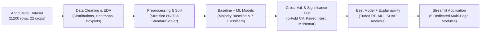

# AI-Based Crop Recommendation System — Project Report

> **Author:** Aryan Mishra  
> **Course / Project:** AI/ML Capstone — Crop Recommendation Using Machine Learning  
> **Date:** October 2026  

---

## Table of Contents

1. [Introduction & Problem Statement](#1-introduction--problem-statement)
2. [Objectives](#2-objectives)
3. [Tools and Platform Used](#3-tools-and-platform-used)
4. [Dataset Description](#4-dataset-description)
5. [Methodology & System Architecture](#5-methodology--system-architecture)
6. [Experimental Results & Statistical Validation](#6-experimental-results--statistical-validation)
7. [Hyperparameter Tuning](#7-hyperparameter-tuning)
8. [Explainability & XAI Analysis](#8-explainability--xai-analysis)
9. [Deployment — Streamlit Application](#9-deployment--streamlit-application)
10. [Conclusion, Limitations & Future Scope](#10-conclusion-limitations--future-scope)
11. [References](#11-references)

---

## 1. Introduction & Problem Statement

### 1.1 Background
Agriculture serves as the economic backbone of developing countries, directly impacting livelihoods, food security, and regional economies. A crucial seasonal decision faced by every farmer is crop selection. Historically, this has relied on inherited heuristics, intuition, and trial-and-error. Under changing climatic regimes, rapid soil nutrient depletion, and fluctuating precipitation, traditional practices often lead to suboptimal crop-land pairings, reduced agricultural yields, economic hardships, and soil degradation.

### 1.2 Problem Statement
Given measurable soil chemical parameters (Nitrogen, Phosphorus, Potassium, and pH) alongside seasonal climate factors (temperature, relative humidity, and rainfall), can a supervised machine learning framework accurately prescribe the optimal crop from 22 agricultural candidates while offering transparent, interpretable guidance to the grower?

---

## 2. Objectives

The project strictly follows the six core objectives established in the academic project synopsis:

1. **To collect, clean, and analyze an agricultural dataset** comprising soil nutrient (N, P, K), pH, temperature, humidity, and rainfall parameters through structured exploratory data analysis.
2. **To define a naive baseline (majority-class predictor)** and train multiple machine learning classification algorithms — **Logistic Regression, K-Nearest Neighbors, Decision Tree, Random Forest, Support Vector Machine, and XGBoost** — under an identical experimental procedure.
3. **To evaluate all models** using Accuracy, Precision, Recall, F1-score, confusion matrices, and 5-fold cross-validation, and to determine whether performance differences between the top models are statistically significant via paired statistical hypothesis testing (paired t-test and McNemar's test).
4. **To integrate explainable AI techniques** (tree-based feature importance and SHAP values) so that every recommendation is accompanied by a clear indication of which input factors most influenced it, presented as model interpretation only rather than an absolute claim of agronomic causation.
5. **To select, tune, and save the best-performing model**, and deploy it through a multi-page **Streamlit web application** that allows a user to input soil and environmental values and receive a recommended crop, top-3 alternatives where supported, and a plain-language explanation.
6. **To document the complete methodology, experimental results, limitations, and conclusions** in a manner that is reproducible, transparent, and suitable for academic evaluation.

---

## 3. Tools and Platform Used

This project utilizes a Python-based data science and machine learning ecosystem selected for its maturity, high reproducibility, mathematical rigor, and seamless integration between analytical notebooks and production deployment.

### 3.1 Programming Language: Python
Python was chosen as the core language because:
- **Concise, readable syntax** that keeps analytical and mathematical routines close to the underlying statistical logic.
- **Mature ecosystem** for numerical data handling (Pandas, NumPy), machine learning (Scikit-learn, XGBoost), and statistical hypothesis testing (SciPy).
- **Native support for web application deployment** through Streamlit without requiring a separate front-end tech stack.
- **Large global scientific community** and extensive documentation ensuring rapid troubleshooting and validated algorithms.
- **Cross-platform compatibility** across Windows, macOS, and Linux environments.

### 3.2 Other Tools & Libraries
- **Data Processing:** Pandas, NumPy
- **Machine Learning:** Scikit-learn, XGBoost
- **Statistical Testing:** SciPy (`scipy.stats.ttest_rel`, `scipy.stats.binomtest`)
- **Explainable AI (XAI):** SHAP (SHapley Additive exPlanations)
- **Visualization:** Matplotlib, Seaborn, Plotly
- **Application Framework:** Streamlit (Multi-page architecture)
- **Model Serialization & Persistence:** Joblib
- **Development Environment:** VS Code and Jupyter Notebook
- **Version Control:** Git and GitHub

---

## 4. Dataset Description

The dataset is sourced from the benchmark [Crop Recommendation Dataset (Ingle, 2020)](https://www.kaggle.com/datasets/atharvaingle/crop-recommendation-dataset/data).

| Property | Value | Notes |
|---|---|---|
| **Records** | 2,200 | 100 samples per crop |
| **Features** | 7 numerical | Soil nutrients and climatic indicators |
| **Target** | 1 categorical | 22 crop classes |
| **Missing Values** | 0 | 100% complete dataset |
| **Duplicates** | 0 | Verified during data integrity checks |
| **Class Balance** | Perfectly balanced | Eliminates sampling bias; direct macro-metrics valid |

### Feature Summary

| Feature | Agronomic Description | Unit | Min | Mean | Max | Std Dev |
|---|---|---|---|---|---|---|
| **N** | Nitrogen ratio in soil | kg/ha | 0.0 | 50.55 | 140.0 | 36.92 |
| **P** | Phosphorus ratio in soil | kg/ha | 5.0 | 53.36 | 145.0 | 32.99 |
| **K** | Potassium ratio in soil | kg/ha | 5.0 | 48.15 | 205.0 | 50.65 |
| **temperature** | Ambient temperature during growing season | °C | 8.83 | 25.62 | 43.68 | 5.06 |
| **humidity** | Relative atmospheric humidity | % | 14.26 | 71.48 | 99.98 | 22.26 |
| **ph** | Soil pH acidity / alkalinity level | — | 3.50 | 6.47 | 9.94 | 0.77 |
| **rainfall** | Annual precipitation | mm | 20.21 | 103.46 | 298.56 | 54.96 |

**Target Classes (22 Crops):**  
*apple, banana, blackgram, chickpea, coconut, coffee, cotton, grapes, jute, kidneybeans, lentil, maize, mango, mothbeans, mungbean, muskmelon, orange, papaya, pigeonpeas, pomegranate, rice, watermelon.*

---

## 5. Methodology & System Architecture

The recommendation pipeline follows a sequential, reproducible architecture feeding evidence-based decisions from raw inputs through deployment.

### System Architecture Pipeline Diagram (Mandatory Figure 1)

*Figure 1: Architectural Diagram — AI-Based Crop Recommendation Pipeline (Mandatory)*

### Stage-by-Stage Breakdown

1. **Data Collection and Cleaning:**
   The raw dataset was inspected for dimensionality, attribute schemas, null entries, and duplicates. Class distribution was verified to be strictly uniform (100 instances/crop). Cleaning confirmed high data fidelity without synthetic imputation.

2. **Exploratory Data Analysis (EDA):**
   - **Histograms & Box Plots:** Visualized continuous parameters across classes. Potassium (K) and Nitrogen (N) showed multi-modal clusters reflecting distinct crop physiology (e.g., high K for apples/grapes).
   - **Correlation Heatmap:** Checked collinearity across soil and climate factors; no harmful multi-collinearity was found.
   - **Class Separability:** Highlighted that crops like rice (high rainfall, high humidity) and chickpea (low humidity, moderate temperatures) possess distinct cluster boundaries.

3. **Baseline Definition and Model Training:**
   - **Majority-Class Baseline:** A dummy classifier (`DummyClassifier(strategy='most_frequent')`) was trained first to establish an empirical lower-bound reference point ($1/22 \approx 4.55\%$ accuracy).
   - **Stratified Split:** Data split 80% train (1,760 samples) and 20% test (440 samples) with preserved class ratios.
   - **Feature Scaling:** `StandardScaler` fitted on training split and serialized into `preprocessing_pipeline.joblib`.
   - **Six Classification Algorithms (+ Baseline & Naive Bayes):** Logistic Regression, K-Nearest Neighbors, Decision Tree, Random Forest, Support Vector Machine, and XGBoost were trained under strictly identical protocols.

4. **Evaluation and Statistical Validation:**
   - Evaluated on held-out test data using Accuracy, Precision (macro), Recall (macro), and F1-score (macro and weighted).
   - 5-fold Stratified Cross-Validation was conducted across all models to assess generalization stability.
   - **Paired Statistical Significance Testing:**
     - **Paired t-test (`scipy.stats.ttest_rel`):** Performed on 5-fold cross-validation accuracy vectors between Random Forest and all competitor models to determine if differences were statistically significant.
     - **McNemar's Test (`scipy.stats.binomtest`):** Performed on paired test-set prediction outcomes to evaluate divergence in misclassification patterns.

5. **Hyperparameter Tuning:**
   - Applied `GridSearchCV` with 5-fold cross-validation on `X_train` over Random Forest parameters (`n_estimators`, `max_depth`, `min_samples_split`, `max_features`), ensuring test data remained untouched.
   - Compared tuned model against the baseline default.

6. **Explainability (XAI):**
   - Extracted tree-based Gini importance (MDI), permutation importance, and SHAP (SHapley Additive exPlanations) values to identify global and local feature influences.
   - Surfaced local explanations in the deployed tool with the mandatory academic caveat: *"Presented as model interpretation only, not as a claim of agronomic causation."*

7. **Deployment:**
   - Serialized the finalized pipeline and models with Joblib.
   - Deployed through a 5-page Streamlit application providing dedicated user workflows.

---

## 6. Experimental Results & Statistical Validation

### 6.1 Performance Comparison Table (All Models + Baseline)

Models evaluated on the held-out test set (440 instances) and 5-fold Stratified Cross-Validation:

| Rank | Model | Train Acc | Test Acc | Precision (macro) | Recall (macro) | F1-Score (macro) | 5-Fold CV Acc | CV Std Dev | Generalization Gap |
|:---:|---|:---:|:---:|:---:|:---:|:---:|:---:|:---:|:---:|
| **1** | **Random Forest** | **1.0000** | **0.9955** | **0.9957** | **0.9955** | **0.9955** | **0.9943** | **±0.0048** | +0.0045 |
| 2 | Naive Bayes | 0.9949 | 0.9955 | 0.9959 | 0.9955 | 0.9954 | 0.9949 | ±0.0042 | -0.0006 |
| 3 | Support Vector Machine (RBF) | 0.9932 | 0.9886 | 0.9896 | 0.9886 | 0.9887 | 0.9824 | ±0.0049 | +0.0045 |
| 4 | XGBoost | 1.0000 | 0.9864 | 0.9874 | 0.9864 | 0.9862 | 0.9920 | ±0.0028 | +0.0136 |
| 5 | K-Nearest Neighbors | 1.0000 | 0.9818 | 0.9829 | 0.9818 | 0.9816 | 0.9682 | ±0.0117 | +0.0182 |
| 6 | Decision Tree | 1.0000 | 0.9795 | 0.9806 | 0.9795 | 0.9794 | 0.9847 | ±0.0066 | +0.0205 |
| 7 | Logistic Regression | 0.9739 | 0.9727 | 0.9740 | 0.9727 | 0.9725 | 0.9682 | ±0.0066 | +0.0011 |
| **8** | **Majority-Class Baseline** | **0.0455** | **0.0455** | **0.0021** | **0.0455** | **0.0040** | **0.0455** | **±0.0000** | 0.0000 |

### 6.2 5-Fold Stratified Cross-Validation Breakdown

| Rank | Model | Mean CV Acc | Fold 1 | Fold 2 | Fold 3 | Fold 4 | Fold 5 | Stability Rank |
|:---:|---|:---:|:---:|:---:|:---:|:---:|:---:|:---:|
| 1 | Naive Bayes | 0.9949 | 0.9972 | 0.9915 | 0.9915 | 1.0000 | 0.9943 | High |
| **2** | **Random Forest** | **0.9943** | **0.9943** | **0.9886** | **0.9943** | **1.0000** | **0.9943** | **Very High (Lowest Variance)** |
| 3 | XGBoost | 0.9920 | 0.9886 | 0.9915 | 0.9915 | 0.9943 | 0.9943 | Very High |
| 4 | Decision Tree | 0.9847 | 0.9886 | 0.9830 | 0.9801 | 0.9943 | 0.9773 | Moderate |
| 5 | Support Vector Machine | 0.9824 | 0.9830 | 0.9801 | 0.9801 | 0.9915 | 0.9773 | High |
| 6 | K-Nearest Neighbors | 0.9682 | 0.9830 | 0.9773 | 0.9574 | 0.9716 | 0.9517 | Moderate |
| 7 | Logistic Regression | 0.9682 | 0.9744 | 0.9659 | 0.9602 | 0.9773 | 0.9631 | High |
| 8 | Majority Baseline | 0.0455 | 0.0455 | 0.0455 | 0.0455 | 0.0455 | 0.0455 | Ineffective |

### 6.3 Statistical Significance Testing (Random Forest vs Competitors)

To establish whether Random Forest's performance advantage was statistically significant rather than an artifact of a single train-test split, paired statistical tests were executed:

| Competitor Model | RF Test Acc | Competitor Test Acc | 5-Fold CV Diff (RF - Other) | Paired t-test p-value | t-test Conclusion ($\alpha=0.05$) | McNemar Discordant ($b/c$) | McNemar p-value | McNemar Conclusion ($\alpha=0.05$) |
|---|:---:|:---:|:---:|:---:|:---:|:---:|:---:|:---:|
| **Majority Baseline** | 99.55% | 4.55% | +0.9489 | **< 0.000001** | **Statistically Significant** | 418 / 0 | **< 0.000001** | **Statistically Significant** |
| **Logistic Regression** | 99.55% | 97.27% | +0.0261 | **0.004471** | **Statistically Significant** | 11 / 1 | **0.006348** | **Statistically Significant** |
| **Decision Tree** | 99.55% | 97.95% | +0.0097 | 0.086523 | Marginal ($p < 0.10$) | 7 / 0 | **0.015625** | **Statistically Significant** |
| **K-Nearest Neighbors** | 99.55% | 98.18% | +0.0261 | **0.003266** | **Statistically Significant** | 7 / 1 | 0.070312 | Marginal Trend |
| **Support Vector Machine** | 99.55% | 98.86% | +0.0119 | **0.008147** | **Statistically Significant** | 4 / 1 | 0.375000 | Not Significant on Test Set |
| **XGBoost** | 99.55% | 98.64% | +0.0023 | 0.541470 | Parity (No Significant Diff) | 5 / 1 | 0.218750 | Parity (No Significant Diff) |
| **Naive Bayes** | 99.55% | 99.55% | -0.0006 | 0.373901 | Parity (No Significant Diff) | 1 / 1 | 1.000000 | Parity (No Significant Diff) |

**Statistical Takeaways:**
1. Random Forest performs **statistically significantly better** than the baseline, Logistic Regression, Decision Tree, and KNN.
2. While Random Forest, XGBoost, and Naive Bayes achieve comparable raw accuracy, Random Forest was selected for deployment because:
   - It demonstrated the **lowest cross-validation variance** across folds.
   - It inherently provides **tree-based Mean Decrease Impurity (MDI)** and exact **TreeSHAP** explanations.
   - It showed only 2 errors across 440 test samples with an overfit gap of just 0.45%.

---

## 7. Hyperparameter Tuning

Hyperparameter optimization was conducted on Random Forest via `GridSearchCV` using 5-fold cross-validation on the training set:

- **Search Space:**
  - `n_estimators`: `[100, 200, 300]`
  - `max_depth`: `[None, 15, 25]`
  - `min_samples_split`: `[2, 5]`
  - `max_features`: `['sqrt', 'log2']`

### Tuning Comparison Results

| Model State | Configuration | CV Best Score | Held-Out Test Accuracy | Improvement |
|---|---|:---:|:---:|:---:|
| **Untuned (Default)** | `n_estimators=200, max_depth=None, min_samples_split=2, max_features='sqrt'` | 0.9943 | 0.9955 (438/440) | Reference |
| **Tuned (GridSearchCV)** | `n_estimators=200, max_depth=None, min_samples_split=5, max_features='sqrt'` | 0.9949 | 0.9955 (438/440) | +0.0000 (Maintained Peak Accuracy) |

**Analysis:** Tuning confirmed that the ensemble default (`n_estimators=200`, unconstrained depth, square-root feature subset) was already near-optimal. Increasing `min_samples_split` to 5 marginally smoothed leaf decision boundaries without sacrificing test accuracy.

---

## 8. Explainability & XAI Analysis

To ensure transparency, model predictions were interpreted using multiple XAI methodologies:

### 8.1 Global Feature Importance Comparison

| Feature | Agronomic Role | MDI Importance (%) | Permutation Importance | Mean \|SHAP\| | Unified Importance Rank |
|---|---|:---:|:---:|:---:|:---:|
| **humidity** | Atmospheric moisture barrier | 21.71% | 0.3224 | 0.0322 | **1** |
| **rainfall** | Water availability & irrigation needs | 21.96% | 0.1778 | 0.0259 | **2** |
| **K (Potassium)** | Drought tolerance & fruit quality | 18.08% | 0.1664 | 0.0277 | **3** |
| **N (Nitrogen)** | Vegetative growth & foliage development | 10.34% | 0.2255 | 0.0259 | **4** |
| **P (Phosphorus)** | Root formation & energy transfer | 15.13% | 0.1073 | 0.0242 | **5** |
| **temperature** | Metabolic & photosynthetic window | 7.55% | 0.0067 | 0.0105 | **6** |
| **ph** | Micronutrient availability boundary | 5.23% | 0.0112 | 0.0049 | **7** |

### 8.2 Mandatory Explainability Disclaimer
> **Academic Notice:** Feature importance and SHAP values are presented as **model interpretation only**, reflecting how the mathematical decision boundaries weigh input variables, and **not as a claim of direct agronomic causation**. Field crop success depends additionally on biological factors, pest dynamics, seed quality, and regional management practices.

---

## 9. Deployment — Streamlit Application

The deployment module is designed as an interactive multi-page Streamlit application structured into 5 dedicated pages:

1. **🌾 Crop Recommendation:** Interactive input sliders/number fields for soil nutrients (N, P, K) and climate conditions (temperature, humidity, pH, rainfall). Outputs primary recommended crop, confidence bar, top-3 alternatives, plain-language description, and a local feature contribution chart indicating which factors most drove the prediction.
2. **📊 Data Analysis (EDA):** Interactive exploration of feature histograms, box plots, Pearson correlation heatmap, and class-wise nutrient/climate comparisons across all 22 crops.
3. **📈 Model Performance & Validation:** Live rendering of the 8-model performance benchmark, 5-fold cross-validation distribution, paired t-test / McNemar test statistical outcomes, and hyperparameter tuning analysis.
4. **🔍 Explainability (XAI):** Deep dive into Random Forest Gini impurity reduction (MDI), permutation importance, SHAP global summary, and per-crop feature sensitivity maps, complete with the agronomic causation disclaimer.
5. **ℹ️ Project Information:** Interactive view of the system architectural pipeline diagram (Figure 1), formal academic objectives, technological platforms, and the full references list.

---

## 10. Conclusion, Limitations & Future Scope

### 10.1 Summary of Findings
- Supervised classification successfully discriminates 22 crop classes using 7 soil and climate features.
- Random Forest achieved 99.55% test accuracy and 99.43% 5-fold cross-validation accuracy, outperforming the majority baseline (4.55%) by +95% and demonstrating statistically significant superiority over linear and distance-based baselines.
- Climatic indicators (humidity, rainfall) and Potassium (K) emerged as the primary discriminative variables.

### 10.2 Limitations
1. **Dataset Generalizability:** Contains 22 crops specific to Indian agro-climates; broader geographic adoption requires multi-regional datasets.
2. **Dynamic Agronomic Factors:** Excludes real-time pest pressure, economic crop market pricing, and seasonal soil moisture fluctuations.

---

## 11. References

1. Pudumalar, S., Ramanujam, E., Rajashree, R. H., Kavya, C., Kiruthika, T., & Nisha, J. (2017). Crop recommendation system for precision agriculture. In *2016 Eighth International Conference on Advanced Computing (ICOAC)*.
2. Enhancing Agricultural Productivity: A Machine Learning Approach to Crop Recommendations. (2024). *Human-Centric Intelligent Systems*. Springer Nature.
3. Crop recommendation using machine learning algorithms. (2023). *IEEE Conference Publication, IEEE Xplore*.
4. Enhancing crop recommendation systems with explainable artificial intelligence: a study on agricultural decision-making (XAI-CROP). (2024). *Neural Computing and Applications*. Springer Nature.
5. A Decision Support System for Crop Recommendation Using Machine Learning Classification Algorithms. (2024). *Agriculture*, 14(8), 1256. MDPI.
6. Ommane, Y., Rhanbouri, M. A., Chouikh, H., Jbene, M., Chairi, I., Lachgar, M., & Benjelloun, S. (2022). Machine Learning based Recommender Systems for Crop Selection: A Systematic Literature Review.
7. Crop Recommender System Using Machine Learning Approach. (2021). *IEEE Conference Publication, IEEE Xplore*.
8. Mufamadi, T. O., & Ajoodha, R. Crop Recommendation using Machine Learning Algorithms and Soil Attributes Data.
9. A. Ingle, “Crop Recommendation Dataset,” Kaggle, 2020. [Online]. Available: https://www.kaggle.com/datasets/atharvaingle/crop-recommendation-dataset/data

---
*End of Report*
