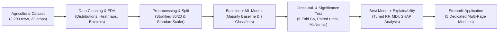

# 🌾 Crop Recommendation System — AI-Based Decision Support System

An end-to-end machine learning project that recommends the optimal crop to grow based on soil nutrient levels (N, P, K), climate conditions (temperature, humidity, rainfall), and soil pH. Built with Scikit-learn, XGBoost, SciPy, and SHAP, and deployed as a multi-page decision support application via Streamlit.


---

## 🎯 Project Objectives

1. **Collect, clean, and analyze an agricultural dataset** comprising soil nutrient (N, P, K), pH, temperature, humidity, and rainfall parameters through structured exploratory data analysis.
2. **Define a naive baseline (majority-class predictor)** and train multiple classification algorithms — **Logistic Regression, K-Nearest Neighbors, Decision Tree, Random Forest, Support Vector Machine, and XGBoost** — under an identical experimental procedure.
3. **Evaluate all models** using Accuracy, Precision, Recall, F1-score, confusion matrices, and 5-fold cross-validation, and determine whether performance differences between top models are statistically significant via paired statistical testing (paired t-test and McNemar's test).
4. **Integrate explainable AI techniques** (tree-based feature importance and SHAP) so that every recommendation is accompanied by a clear indication of which input factors most influenced it, presented as model interpretation only, not as a claim of agronomic causation.
5. **Select, tune, and save the best-performing model**, and deploy it through a multi-page **Streamlit web application** that allows a user to input soil and environmental values and receive a recommended crop, top-3 alternatives where supported, and a plain-language explanation.
6. **Document the complete methodology, experimental results, limitations, and conclusions** in a reproducible manner suitable for academic evaluation.

---

## 🏗️ System Architecture


*Figure 1: Architectural Diagram — AI-Based Crop Recommendation Pipeline (Mandatory)*

---

## 🛠️ Tools & Platform Used

- **Programming Language:** Python
- **Data Processing:** Pandas, NumPy
- **Machine Learning:** Scikit-learn, XGBoost
- **Statistical Testing:** SciPy (`scipy.stats.ttest_rel`, `scipy.stats.binomtest`)
- **Explainability (XAI):** SHAP (SHapley Additive exPlanations)
- **Visualization:** Matplotlib, Seaborn, Plotly
- **Application Framework:** Streamlit (Multi-page architecture)
- **Model Persistence:** Joblib
- **Development Environment:** VS Code and Jupyter Notebook
- **Version Control:** Git and GitHub

---

## 📊 Experimental Results & Statistical Validation

### 1. Model Performance Benchmark (Including Majority Baseline)

| Rank | Model | Train Acc | Test Acc | Precision (macro) | Recall (macro) | F1-Score (macro) | 5-Fold CV Acc | CV Std Dev |
|:---:|---|:---:|:---:|:---:|:---:|:---:|:---:|:---:|
| **1** | **Random Forest** | **1.0000** | **99.55%** | **99.57%** | **99.55%** | **99.55%** | **99.43%** | **±0.0048** |
| 2 | Naive Bayes | 0.9949 | 99.55% | 99.59% | 99.55% | 99.54% | 99.49% | ±0.0042 |
| 3 | Support Vector Machine | 0.9932 | 98.86% | 98.96% | 98.86% | 98.87% | 98.24% | ±0.0049 |
| 4 | XGBoost | 1.0000 | 98.64% | 98.74% | 98.64% | 98.62% | 99.20% | ±0.0028 |
| 5 | K-Nearest Neighbors | 1.0000 | 98.18% | 98.29% | 98.18% | 98.16% | 96.82% | ±0.0117 |
| 6 | Decision Tree | 1.0000 | 97.95% | 98.06% | 97.95% | 97.94% | 98.47% | ±0.0066 |
| 7 | Logistic Regression | 0.9739 | 97.27% | 97.40% | 97.27% | 97.25% | 96.82% | ±0.0066 |
| **8** | **Majority-Class Baseline** | **0.0455** | **4.55%** | **0.21%** | **4.55%** | **0.40%** | **4.55%** | **±0.0000** |

### 2. Paired Statistical Hypothesis Testing (vs Random Forest)

| Competitor Model | 5-Fold CV Diff (RF - Other) | Paired t-test p-value | t-test Result ($\alpha=0.05$) | McNemar Discordant ($b/c$) | McNemar p-value | McNemar Result ($\alpha=0.05$) |
|---|:---:|:---:|:---:|:---:|:---:|:---:|
| **Majority Baseline** | +0.9489 | **< 0.000001** | **Significant** | 418 / 0 | **< 0.000001** | **Significant** |
| **Logistic Regression** | +0.0261 | **0.004471** | **Significant** | 11 / 1 | **0.006348** | **Significant** |
| **Decision Tree** | +0.0097 | 0.086523 | Marginal ($p < 0.10$) | 7 / 0 | **0.015625** | **Significant** |
| **K-Nearest Neighbors** | +0.0261 | **0.003266** | **Significant** | 7 / 1 | 0.070312 | Marginal Trend |
| **Support Vector Machine** | +0.0119 | **0.008147** | **Significant** | 4 / 1 | 0.375000 | Not Significant on Test Set |
| **XGBoost** | +0.0023 | 0.541470 | Parity | 5 / 1 | 0.218750 | Parity |
| **Naive Bayes** | -0.0006 | 0.373901 | Parity | 1 / 1 | 1.000000 | Parity |

### 3. Hyperparameter Tuning (Random Forest)
- Search: `GridSearchCV` with 5-fold CV over `n_estimators`, `max_depth`, `min_samples_split`, and `max_features`.
- Best Params: `{'n_estimators': 200, 'max_depth': None, 'min_samples_split': 5, 'max_features': 'sqrt'}`.
- Held-out test accuracy maintained at **99.55%** (438/440 correct), validating optimal default generalization.

---

## 🔍 Explainability & Interpretability

- **MDI Impurity Ranking:** Rainfall (21.96%), Humidity (21.71%), Potassium (18.08%), Phosphorus (15.13%), Nitrogen (10.34%), Temperature (7.55%), pH (5.23%).
- **SHAP Game-Theoretic Ranking:** Humidity, Potassium, Rainfall, Nitrogen, Phosphorus, Temperature, pH.
- **Academic Disclaimer:** *Feature importance and SHAP values are surfaced as model interpretation only, not as a claim of agronomic causation.*

---

## 🖥️ Streamlit Multi-Page Web Application

The application is organized into 5 dedicated pages:

1. **🌾 Crop Recommendation:** User input form with agronomic validation, recommended crop, confidence score, top-3 alternatives, plain-language description, and local feature contribution chart.
2. **📊 Data Analysis (EDA):** Interactive feature distributions, histograms, box plots, correlation heatmap, and class-wise comparisons.
3. **📈 Model Performance & Validation:** Baseline comparison, 5-fold cross-validation distribution, paired t-test and McNemar statistical tests, confusion matrices, and hyperparameter tuning analysis.
4. **🔍 Explainability (XAI):** MDI Gini importance, permutation importance, global SHAP summary, per-crop importance breakdown, and agronomic interpretation.
5. **ℹ️ Project Information:** Mandatory Figure 1 pipeline diagram, academic objectives, platform details, and full citations.

```bash
# Launch Streamlit Multi-Page App
streamlit run app.py
```
Open **http://localhost:8501** in your browser.

---

## 📚 References

1. Pudumalar, S., Ramanujam, E., Rajashree, R. H., Kavya, C., Kiruthika, T., & Nisha, J. (2017). Crop recommendation system for precision agriculture. In *2016 Eighth International Conference on Advanced Computing (ICOAC)*.
2. Enhancing Agricultural Productivity: A Machine Learning Approach to Crop Recommendations. (2024). *Human-Centric Intelligent Systems*. Springer Nature.
3. Crop recommendation using machine learning algorithms. (2023). *IEEE Conference Publication, IEEE Xplore*.
4. Enhancing crop recommendation systems with explainable artificial intelligence: a study on agricultural decision-making (XAI-CROP). (2024). *Neural Computing and Applications*. Springer Nature.
5. A Decision Support System for Crop Recommendation Using Machine Learning Classification Algorithms. (2024). *Agriculture*, 14(8), 1256. MDPI.
6. Ommane, Y., Rhanbouri, M. A., Chouikh, H., Jbene, M., Chairi, I., Lachgar, M., & Benjelloun, S. (2022). Machine Learning based Recommender Systems for Crop Selection: A Systematic Literature Review.
7. Crop Recommender System Using Machine Learning Approach. (2021). *IEEE Conference Publication, IEEE Xplore*.
8. Mufamadi, T. O., & Ajoodha, R. Crop Recommendation using Machine Learning Algorithms and Soil Attributes Data.
9. A. Ingle, “Crop Recommendation Dataset,” Kaggle, 2020. [Online]. Available: https://www.kaggle.com/datasets/atharvaingle/crop-recommendation-dataset/data
