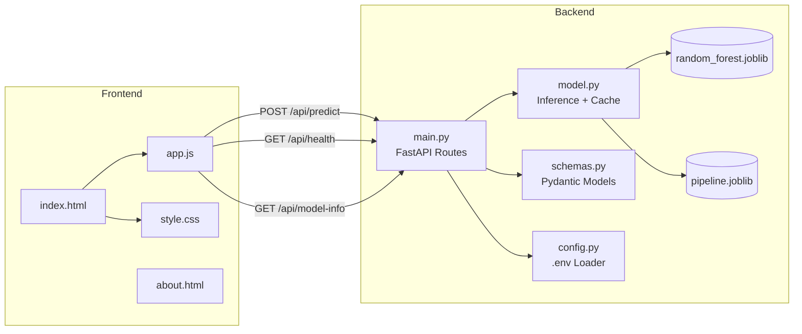

# 🌾 CropAdvisor — Web Application

Production-quality full-stack web application for the AI-based Crop Recommendation System.

- **Backend:** FastAPI REST API with Pydantic v2 validation, request logging, and prediction caching
- **Frontend:** Responsive HTML/CSS/JS with premium agriculture-themed dark UI, glassmorphism, canvas charts
- **Model:** Random Forest (99.55% accuracy, 22 crop classes) loaded via joblib

---

## Architecture



---

## Quick Start

### Option 1 — Run Locally

```bash
# From the project root (Crop/)
cd webapp

# Activate the virtual environment
..\.venv\Scripts\Activate.ps1   # Windows PowerShell
# source ../.venv/bin/activate  # macOS/Linux

# Install dependencies (if not already installed)
pip install -r requirements.txt

# Start the server
uvicorn backend.main:app --reload --port 8000
```

Open **http://localhost:8000** in your browser.

### Option 2 — Docker

```bash
# From the webapp/ directory
docker-compose up --build
```

Open **http://localhost:8000**.

---

## API Reference

Interactive Swagger documentation: **http://localhost:8000/docs**
ReDoc alternative: **http://localhost:8000/redoc**

| Method | Endpoint | Description |
|--------|----------|-------------|
| `POST` | `/api/predict` | Get crop recommendation |
| `GET` | `/api/model-info` | Model metadata & metrics |
| `GET` | `/api/health` | Health check |
| `GET` | `/docs` | Swagger UI |
| `GET` | `/redoc` | ReDoc documentation |

### Example Request

```bash
curl -X POST http://localhost:8000/api/predict \
  -H "Content-Type: application/json" \
  -d '{
    "N": 80, "P": 48, "K": 40,
    "temperature": 23.5, "humidity": 82.0,
    "ph": 6.5, "rainfall": 236.0
  }'
```

### Example Response

```json
{
  "recommended_crop": "rice",
  "confidence": 93.5,
  "emoji": "🍚",
  "info": "Thrives in warm, humid climates with heavy rainfall.",
  "top3": [
    { "crop": "rice", "probability": 93.5, "emoji": "🍚", "info": "..." },
    { "crop": "jute", "probability": 6.48, "emoji": "🪢", "info": "..." },
    { "crop": "papaya", "probability": 0.01, "emoji": "🍈", "info": "..." }
  ],
  "all_probabilities": { "rice": 93.5, "jute": 6.48, "..." : "..." },
  "input_summary": {
    "N": 80, "P": 48, "K": 40,
    "temperature": 23.5, "humidity": 82.0,
    "ph": 6.5, "rainfall": 236.0
  }
}
```

### Response Headers

Each response includes:
- `X-Request-ID` — Unique identifier for request tracing
- `X-Response-Time` — Server-side processing time

---

## Running Tests

```bash
cd webapp
python -m pytest tests/ -v
```

**35+ tests** covering:
- ✅ Health check and model loading
- ✅ Valid predictions across multiple scenarios (rice, apple, maize, coffee)
- ✅ Input validation (missing fields, out-of-range, wrong types)
- ✅ Edge cases (all min/max boundary values, float precision)
- ✅ Response structure (top-3 uniqueness, probability sum ~100%)
- ✅ Performance (prediction <500ms, health <100ms)
- ✅ Frontend serving (HTML pages)
- ✅ Custom headers (request ID, response time)

---

## Folder Structure

```
webapp/
├── backend/
│   ├── __init__.py
│   ├── main.py           # FastAPI app, routes, middleware, error handling
│   ├── model.py           # Model loading, inference, caching
│   ├── schemas.py         # Pydantic request/response models
│   └── config.py          # Environment configuration & logging
├── frontend/
│   ├── index.html         # Main page (form + results + donut chart + history)
│   ├── about.html         # Methodology, metrics, crop gallery, feature importance
│   ├── css/style.css      # Premium design system (glassmorphism, animations)
│   └── js/app.js          # Frontend logic (canvas charts, confetti, validation)
├── tests/
│   ├── __init__.py
│   └── test_api.py        # 35+ API tests
├── .env                   # Environment config
├── .dockerignore          # Docker build exclusions
├── Dockerfile             # Multi-stage Docker build
├── docker-compose.yml     # Docker Compose config
├── requirements.txt       # Pinned Python dependencies
└── README.md              # This file
```

---

## Deployment Guide

### Render

1. Push to GitHub
2. Create a new **Web Service** on [render.com](https://render.com)
3. Set build command: `pip install -r webapp/requirements.txt`
4. Set start command: `cd webapp && uvicorn backend.main:app --host 0.0.0.0 --port $PORT`
5. Add environment variables from `.env`

### Railway

1. Push to GitHub
2. Create a new project on [railway.app](https://railway.app)
3. Set the root directory to `webapp/`
4. Railway auto-detects the Dockerfile

### Docker (any cloud — AWS ECS, GCP Cloud Run, Azure Container Apps)

```bash
# Build from the project root (Crop/)
docker build -t crop-advisor -f webapp/Dockerfile .

# Run
docker run -p 8000:8000 crop-advisor
```

### AWS EC2

```bash
# SSH into your EC2 instance
ssh -i your-key.pem ec2-user@your-ip

# Install Docker
sudo yum install docker -y && sudo systemctl start docker

# Clone and build
git clone <your-repo-url> && cd Crop
docker build -t crop-advisor -f webapp/Dockerfile .
docker run -d -p 80:8000 --name crop-app crop-advisor
```

---

## Environment Variables

| Variable | Default | Description |
|----------|---------|-------------|
| `MODEL_PATH` | `models/random_forest.joblib` | Path to trained model file |
| `PIPELINE_PATH` | `preprocessing_pipeline.joblib` | Path to preprocessing pipeline |
| `HOST` | `0.0.0.0` | Server bind host |
| `PORT` | `8000` | Server bind port |
| `CORS_ORIGINS` | `*` | Comma-separated CORS origins |
| `LOG_LEVEL` | `INFO` | Logging level (DEBUG, INFO, WARNING, ERROR) |
| `DEBUG` | `false` | Enable debug mode |
| `API_PREFIX` | `/api` | API route prefix |

---

## Troubleshooting

| Issue | Solution |
|-------|----------|
| `ModuleNotFoundError: No module named 'backend'` | Run from the `webapp/` directory: `cd webapp && uvicorn backend.main:app` |
| `FileNotFoundError: Model file not found` | Check that `MODEL_PATH` in `.env` points to a valid model file relative to `Crop/` |
| Port already in use | Change the port: `uvicorn backend.main:app --port 8001` |
| CORS errors in browser | Set `CORS_ORIGINS=http://localhost:3000` (or whatever your frontend URL is) |
| Docker build fails | Ensure you're building from the `Crop/` root: `docker build -f webapp/Dockerfile .` |

---

## Performance

| Metric | Value |
|--------|-------|
| Model load time | ~150ms |
| Prediction latency | <10ms (cached: <1ms) |
| Docker image size | ~350MB (multi-stage) |
| Test suite execution | <5 seconds |
